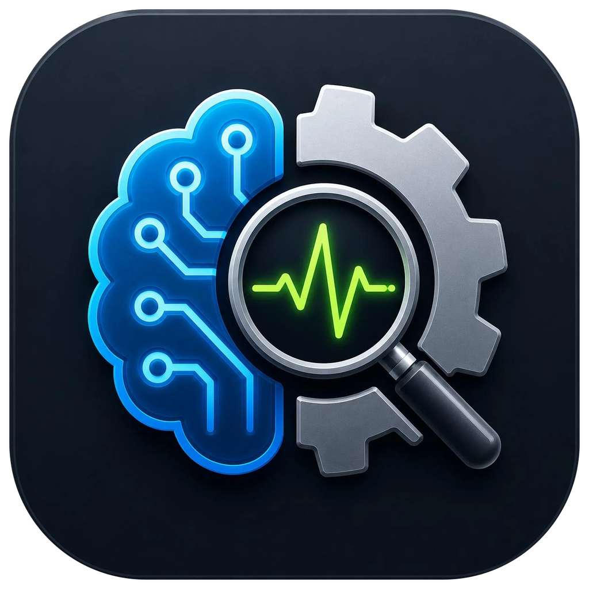
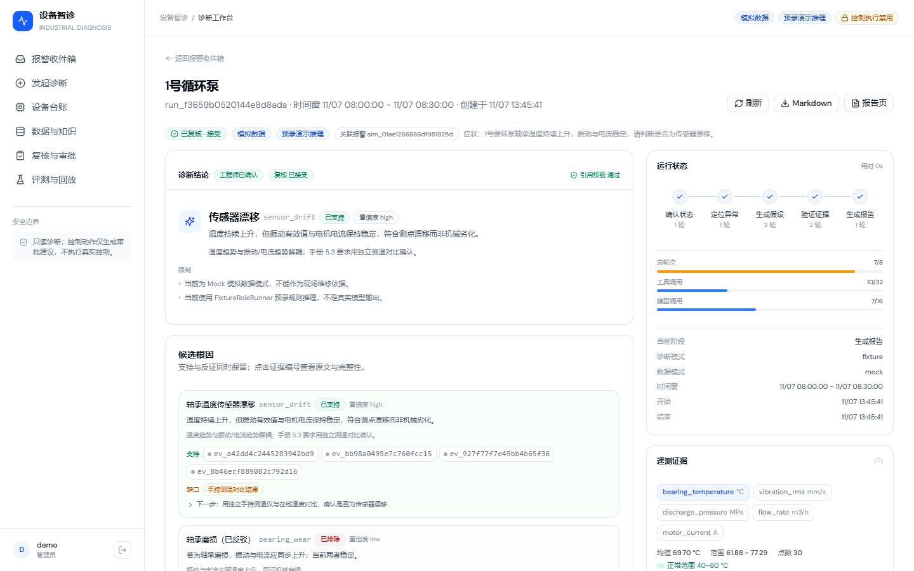
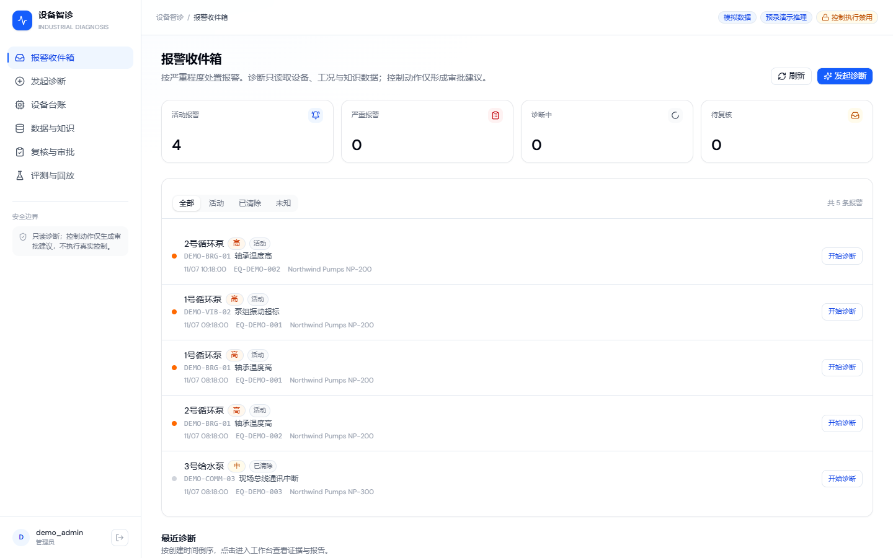
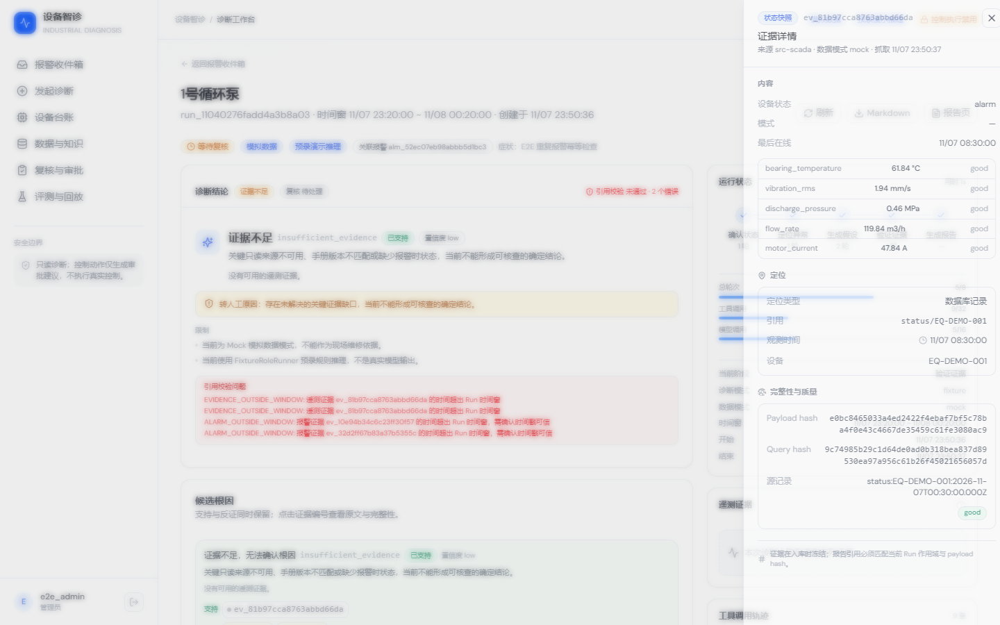
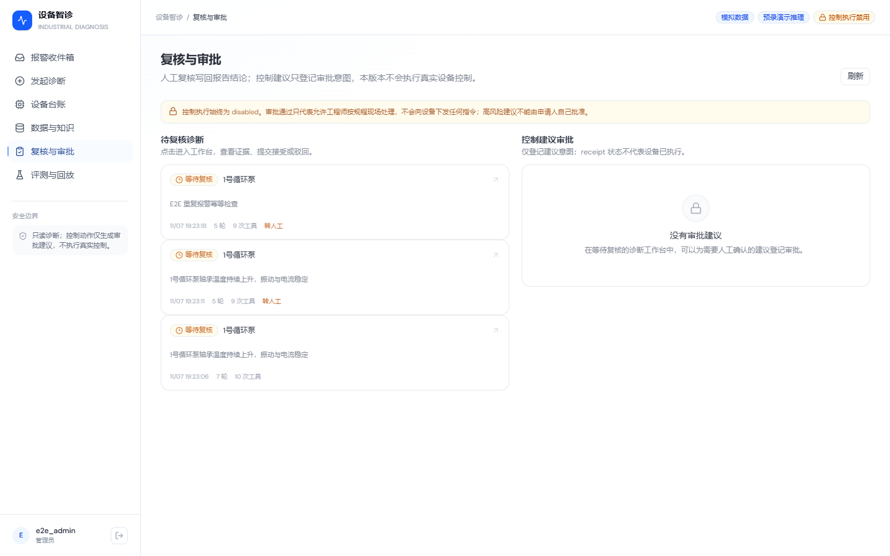
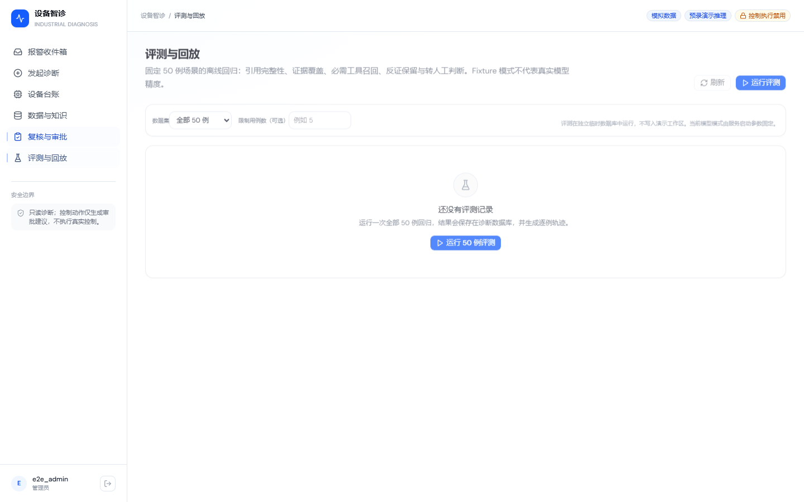
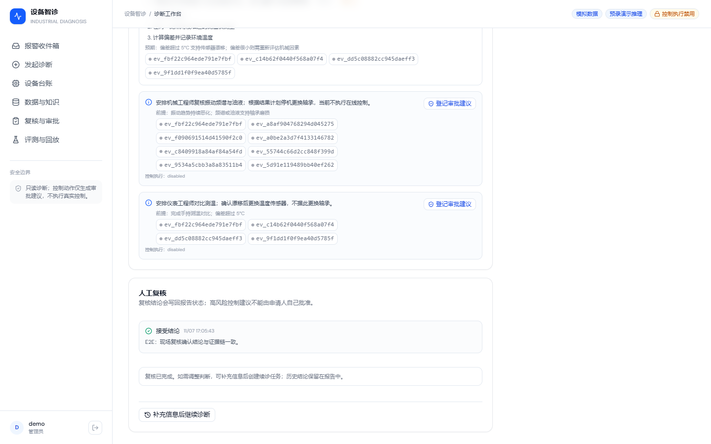
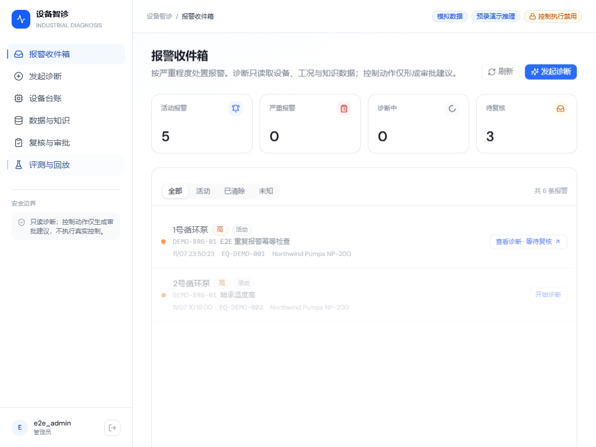
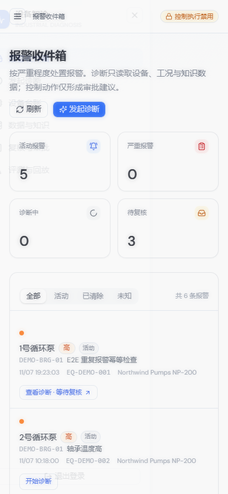
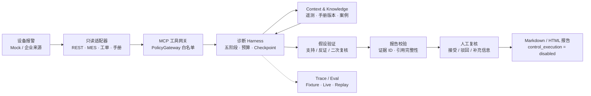

# Industrial Diagnosis Agent

<p align="center">
  
</p>

<p align="center">
  <strong>工业设备故障诊断智能体</strong><br />
  从一条设备报警开始，用只读工具收集证据、验证假设，输出每条结论都可追溯的诊断报告，并把最终判断交给人。
</p>

<p align="center">
  <a href="https://github.com/Akaliup/industrial-diagnosis-agent/actions/workflows/ci.yml"></a>
  <a href="https://github.com/Akaliup/industrial-diagnosis-agent/actions/workflows/diagnosis-ci.yml"></a>
  <a href="LICENSE"></a>
</p>

<p align="center">
  <a href="docs/diagnosis/DEMO.md">3 分钟演示</a> ·
  <a href="docs/diagnosis/ARCHITECTURE.md">架构</a> ·
  <a href="docs/diagnosis/ACCEPTANCE.md">验收报告</a> ·
  <a href="docs/diagnosis/PROJECT_STORY.md">项目复盘</a> ·
  <a href="docs/diagnosis/README.md">文档索引</a>
</p>

> **默认零配置可跑**：`fixture` 模型 + `mock` 数据，不需要 API Key。
> 真实模型、企业来源与设备控制分别有明确的状态边界，不会用 Mock 冒充现场结果。

## 它解决什么问题

工业现场的一条“轴承温度高”报警，可能来自传感器漂移、润滑不足、轴承磨损，也可能只是通讯误报。传统做法依赖工程师在多个系统之间翻遥测、查手册、找工单，结论难以复核。

本项目把这段过程做成一条可审计的诊断链路：

- **只读取数**：设备、遥测、报警、MES、工单、手册、案例统一为六个只读 MCP 工具。
- **五阶段推理**：确认状态 → 定位异常 → 生成假设 → 验证证据 → 生成报告，阶段间有预算与检查点。
- **证据链**：每个结论绑定确定性证据 ID、来源定位与 payload hash；支持证据与反证同时保留。
- **人工兜底**：证据不足或来源超时会明确转人工，不编造结论；控制执行始终禁用。
- **可回归**：50 例 Fixture Eval、Trace Replay 与 CI 门禁，把 Agent 行为当作工程产物验证。

## 产品界面

### 诊断工作台

五阶段状态、候选根因、支持/反证证据、预算与工具轨迹在同一个页面完成。

<p align="center">
  
</p>

### 报警收件箱与证据抽屉

<p align="center">
  
  
</p>

### 人工复核与评测回放

<p align="center">
  
  
</p>

<p align="center">
  
</p>

<details>
<summary>响应式界面（平板 / 手机）</summary>
<p align="center">
  
  
</p>
</details>

> 以上截图由 Playwright 在真实运行的 Backend + MCP + Web 上生成，未使用静态 HTML 或合成图。
> 页面中的“模拟数据 / 预录演示推理 / 控制执行禁用”标识是产品状态的一部分。

## 核心能力

| 能力                    | 实现                                                                                                                                                                                                     |
| ----------------------- | -------------------------------------------------------------------------------------------------------------------------------------------------------------------------------------------------------- |
| **五阶段 Harness**      | `confirm_status → locate_anomaly → generate_hypotheses → verify_evidence → produce_report`，阶段事件可回放；每阶段有轮次与 token 预算                                                                    |
| **MCP 设备查询**        | 六个只读工具：`equipment_resolve`、`equipment_query`（状态/遥测/报警/MES/工单）、`maintenance_search_manual`、`maintenance_get_manual_section`、`maintenance_search_cases`、`evidence_get`；Zod 严格校验 |
| **动态假设与复核**      | 模型可提出多个竞争假设；验证阶段支持二次复核与补充检查，反证不会被静默丢弃                                                                                                                               |
| **Context / 手册检索**  | 每轮记录上下文来源与预算清单；手册引用绑定文档版本，撤回版本会使引用失效                                                                                                                                 |
| **Evidence / Citation** | 证据 ID 在入库时按 Workspace、Run、来源、记录、payload hash 确定性重算；报告引用逐条校验设备、时间窗、机型与手册版本                                                                                     |
| **PolicyGateway**       | 工具白名单、角色/设备范围、参数校验、重复调用守卫、租约 token；越权与未知工具直接拒绝                                                                                                                    |
| **人工复核**            | 报告进入复核队列；接受/驳回/补充信息都会回写报告状态；高风险建议不能由申请人自己批准                                                                                                                     |
| **Checkpoint / 容错**   | 预算耗尽、worker 崩溃、取消、迟到回执都有明确状态；恢复时不会把未知回执当成成功                                                                                                                          |
| **Agent Eval / Replay** | 50 例离线评测、逐例 Trace、只读 Trace Replay、回归门禁；指标覆盖 Top-1/Top-3、证据覆盖、工具选择、反证保留、转人工准确率                                                                                 |
| **报告导出**            | 工作台直接导出 Markdown 或打开 HTML 报告页；报告包含引用、限制、复核状态与免责声明                                                                                                                       |

## 架构



**数据与模型状态是分开的**：

| 维度     | 当前状态         | 说明                                                                                  |
| -------- | ---------------- | ------------------------------------------------------------------------------------- |
| 演示数据 | `mock` / Fixture | 仓库内为虚构设备、时序、报警、手册与案例                                              |
| 真实模型 | 已验证，当前暂停 | 已用授权 DeepSeek 兼容端点跑过 dev 试点与全量 50 例；最终复验因 HTTP 402 为 `NOT_RUN` |
| 企业来源 | `UNCONFIGURED`   | 适配器与字段映射已就绪，未接入真实 SCADA / MES / RootCloud                            |
| 设备控制 | `disabled`       | 本版本没有控制工具；审批只登记意图，不下发指令                                        |

## 3 分钟本地演示

环境要求：Node.js 20+、npm。默认路径不需要 Docker、不需要模型 API Key。

```bash
git clone https://github.com/Akaliup/industrial-diagnosis-agent.git
cd industrial-diagnosis-agent

npm install
npm --prefix web install
npm --prefix packages/industrial-diagnosis-mcp install

npm run diagnosis:build:mcp
npm run build:web

npm run diagnosis:setup
npm run diagnosis:server
```

打开 **<http://127.0.0.1:3100/diagnosis>**。

1. 首次打开按向导创建管理员。
2. 在报警收件箱点击“载入演示数据”（幂等）。
3. 打开 `1号循环泵 / DEMO-BRG-01 / 轴承温度高`，点击“开始诊断”。
4. 等待五阶段完成，查看“传感器漂移”结论、支持/反证证据与预算。
5. 点击任意 `ev_...` 打开证据抽屉；滚动到“人工复核”提交意见。
6. 在“评测与回放”查看 50 例 Fixture 结果并打开逐例 Trace。
7. 右上角导出 Markdown 或打开 HTML 报告页。

端口占用时设置 `DIAGNOSIS_PORT=3101`。完整步骤、截图复现命令与演示时不要做的事见
[`docs/diagnosis/DEMO.md`](docs/diagnosis/DEMO.md)。

## 评测结果

Fixture 与真实模型必须分开看。**Fixture 50/50 只代表工程回归，不代表真实模型精度。**

| 验证                       | 结果                                                        | 说明                                                                         |
| -------------------------- | ----------------------------------------------------------- | ---------------------------------------------------------------------------- |
| Fixture 回归门禁（50 例）  | **50/50 PASS**                                              | 引用完整性、证据覆盖、工具选择、反证保留、转人工判断均为 1.0；`越权调用 = 0` |
| DeepSeek dev 试点（10 例） | **10/10**                                                   | 历史结果，已授权兼容端点；65 次模型调用、0 失败                              |
| DeepSeek 全量 50 例        | **23/50**                                                   | 历史结果（dev 14/29、holdout 9/21）；使用修复前预算，是下界                  |
| Phase 3 定向真实模型       | **机械 2/2、`mul-align-lube` 1/1、`mul-bearing-drift` 1/1** | 只覆盖定向用例，不外推为全量或现场精度                                       |
| Phase 3 最终 10 例复验     | **NOT_RUN**                                                 | 第一次模型调用 HTTP 402 余额不足；未自动重试、未充值                         |
| 诊断测试                   | **140 个**（23 文件）                                       | 覆盖编排、预算、取消、崩溃恢复、证据校验、Webhook、Eval 与 Trace Replay      |

失败类别、逐例 Trace 与“为什么不把 3 个截断用例事后改判为通过”的说明见
[`docs/diagnosis/ACCEPTANCE.md`](docs/diagnosis/ACCEPTANCE.md) §6。

## 技术栈

- **运行时**：Node.js 20+、TypeScript、tsx
- **服务端**：Hono、better-sqlite3（SQLite + FTS5）、Zod、WebSocket
- **Agent / 工具**：MCP stdio JSON-RPC、Pi Agent Runtime（底层工作台复用）
- **前端**：React 19、Vite、Tailwind CSS 4、Radix UI、React Router、Zustand
- **桌面**：Electron（Main / Preload / Renderer 分层，Renderer 不接触数据库与凭证）
- **测试**：Vitest、Playwright
- **CI**：GitHub Actions（`CI`、`Diagnosis CI`）

## 安全与当前边界

- **只读**：诊断工具固定为六个只读工具；未知工具、控制工具、越界设备与额外参数会被网关拒绝。
- **不控制设备**：`control_execution` 始终为 `disabled`；审批只记录建议意图，不触发任何设备动作。
- **不伪造证据**：证据 ID 入库重算；报告引用必须匹配 Run 作用域、时间窗、机型与 payload hash。
- **不静默回退**：来源超时或证据不足转人工；`live` 模式不会回退 Mock；未配置真实模型时 Live Eval 为 `NOT_RUN`。
- **权限边界**：Workspace ACL、owner、角色与系统权限在服务端共同判定；高风险建议不能由申请人自己批准。
- **凭证**：API Key 只存在本机 `.env.diagnosis`，不写入 Trace、报告、截图或仓库。
- **未接入真实企业系统**：没有真实 SCADA / MES / RootCloud 数据；本机假 REST 只用于验证配置链路。

安全问题请参考 [`SECURITY.md`](SECURITY.md)，完整权限矩阵见 [`docs/ACL-MATRIX.md`](docs/ACL-MATRIX.md)。

## 底层架构与开源复用

诊断链路运行在同一个自托管 Agent 工作台上，复用其登录、Workspace、Session、Memory、
Skills/MCP/Plugins、渠道与定时任务能力。诊断页面是独立入口，不恢复通用 Agent 的工具权限。

```text
Web / Electron / IM Channels
        │
        ▼
Backend：Auth · API · Queue · Scheduler · ACL · SQLite
        │
        ▼
Pi Agent Runtime（Host / Docker）
        │
        ▼
诊断 Harness + MCP 只读工具
```

通用工作台采用智能体优先工作模型，其 Agent Profile、Workspace、Session、Memory、
Skills/MCP/Plugins、渠道接入、Scheduler 与 Electron Shell 不在这里展开，避免掩盖工业诊断主线；需要时从
[`docs/API.md`](docs/API.md) 与 [`docs/ACL-MATRIX.md`](docs/ACL-MATRIX.md) 进入。

**来源与许可证**：本项目基于 MIT 基线工程，保留其 Node/TypeScript、Hono、React、SQLite、
鉴权、Web 构建与 CI 结构；交互模式参考 Craft Agents 0.11.4（Apache-2.0），未复制其运行时
实现。详细复用边界见 [`docs/diagnosis/SOURCE_PROVENANCE.md`](docs/diagnosis/SOURCE_PROVENANCE.md)。

## 文档

- [`docs/diagnosis/DEMO.md`](docs/diagnosis/DEMO.md) — 3–5 分钟演示、截图复现与报告导出
- [`docs/diagnosis/ARCHITECTURE.md`](docs/diagnosis/ARCHITECTURE.md) — 组件、五阶段、Tool Schema、数据模型、事件协议
- [`docs/diagnosis/ACCEPTANCE.md`](docs/diagnosis/ACCEPTANCE.md) — 实测命令、退出码、50 例指标、E2E 与剩余条件
- [`docs/diagnosis/PROJECT_STORY.md`](docs/diagnosis/PROJECT_STORY.md) — 本人新增工作、难点、Codex Review 修复记录
- [`docs/diagnosis/SOURCE_PROVENANCE.md`](docs/diagnosis/SOURCE_PROVENANCE.md) — 来源、许可证与复用边界
- [`docs/API.md`](docs/API.md) — HTTP API、认证与主要资源接口
- [`docs/ACL-MATRIX.md`](docs/ACL-MATRIX.md) — 用户、Workspace、Channel、Host 与任务权限矩阵
- [`SECURITY.md`](SECURITY.md) — 安全问题报告与处理策略

## License

MIT License，详见 [`LICENSE`](LICENSE)。
