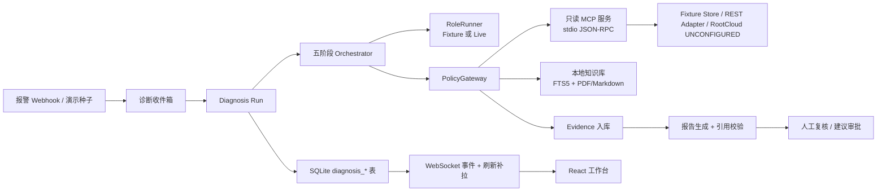

# 设备智诊架构

## 1. 总览



- Web 入口：`/diagnosis`，独立 SPA（HashRouter），复用 Miniclaw 登录与 Workspace。
- 服务入口：`src/diagnosis/server.ts`，只挂载 `/api/auth` 与 `/api/diagnosis`。
- 诊断状态真相源：SQLite 的 `diagnosis_*` 表；WebSocket 只是通知通道。
- 通用 Miniclaw Agent 的工具权限不被诊断链路使用；诊断工具固定白名单。

## 2. 五阶段

| 阶段 | 目标 | 典型工具 | 退出条件 |
| --- | --- | --- | --- |
| `confirm_status` | 确认设备状态、报警真实性、数据可用性 | `equipment_resolve`、`equipment_query(status/alarms)` | 状态与报警窗口明确 |
| `locate_anomaly` | 定位温度/振动/电流/压力/流量异常 | `equipment_query(telemetry/mes_events/work_orders)` | 关键测点趋势与时间窗明确 |
| `generate_hypotheses` | 生成候选根因与判别条件 | 手册/案例检索、`evidence_get` | 至少一个可验证假设 |
| `verify_evidence` | 按假设补查、保留反证、检查证据缺口 | 手册条款、历史案例、补充时序 | 支持/反证/缺口明确 |
| `produce_report` | 生成报告、逐条引用校验 | `evidence_get`、校验器 | 校验通过或明确转人工 |

预算默认值：8 轮总轮次、3 轮/阶段、32 次逻辑工具调用、3 次/调用尝试、16 次模型调用、
300 秒墙钟、单查询窗口 ≤24 小时、无新证据轮次 ≤3。证据不足或来源失败进入
`awaiting_human`，不生成确定结论。

## 3. 角色与工具权限矩阵

| 工具 | 风险 | data_investigator | knowledge_retriever | hypothesis_verifier | report_reviewer |
| --- | --- | --- | --- | --- | --- |
| `equipment_resolve` | read | ✓ | — | ✓ | — |
| `equipment_query` | read | ✓ | — | ✓ | — |
| `maintenance_search_manual` | knowledge_read | — | ✓ | ✓ | — |
| `maintenance_get_manual_section` | knowledge_read | — | ✓ | ✓ | — |
| `maintenance_search_cases` | knowledge_read | — | ✓ | ✓ | — |
| `evidence_get` | read | ✓ | ✓ | ✓ | ✓ |
| 任意 Bash/Write/控制工具 | — | ✗ | ✗ | ✗ | ✗ |

网关顺序：认证 → Workspace/Run → 角色白名单 → 严格 Schema → 设备作用域 → 风险 →
预算 → 重复调用守卫 → 执行 → 证据入库。未知工具、控制风险、越界设备、额外字段一律拒绝。

## 4. Tool Schema（输入摘要）

| 工具 | 输入 |
| --- | --- |
| `equipment_resolve` | `query`(1-128)、可选 `vendor`、`model`；严格对象 |
| `equipment_query` | `equipment_id`、`query_kind`(status/telemetry/alarms/mes_events/work_orders)、可选 `alarm_code`、`window`、`metrics[]`、`limit`、`cursor` |
| `maintenance_search_manual` | `query`(1-200)、可选 `equipment_model`、`manual_version`、`limit` |
| `maintenance_get_manual_section` | `document_id`、可选 `chunk_id`、`page` |
| `maintenance_search_cases` | `query`、可选 `equipment_model`、`asset_category`、`limit` |
| `evidence_get` | `evidence_ids[]`(1-50) |

所有输入 `.strict()`，未知字段拒绝。工具输出统一为 `ToolResponseEnvelope`：
`schema_version / request_id / logical_call_id / data_mode / status / data / evidence /
coverage / warnings / error / next_cursor`。`status` 为 `success|partial|no_data|error`。

## 5. 数据模型

| 表 | 用途 |
| --- | --- |
| `diagnosis_meta` | 诊断 Schema 版本 |
| `equipment_registry` | 设备台账快照（型号、厂商、序列号） |
| `diagnosis_sources` | 来源配置与状态（mock/replay/live、UNCONFIGURED） |
| `diagnosis_alarms` | 报警入库与幂等键 |
| `diagnosis_runs` | Run 状态、阶段、预算、租约、checkpoint、复核状态 |
| `diagnosis_hypotheses` | 候选根因、状态、支持/反证证据 |
| `diagnosis_evidence` | 证据载荷、hash、来源定位、质量标记 |
| `diagnosis_tool_calls` | 每次逻辑调用与尝试、策略决策、耗时 |
| `diagnosis_events` | Run 内单调 `seq` 事件 |
| `diagnosis_reports` | 报告 JSON 与校验结果 |
| `diagnosis_reviews` | 人工复核记录 |
| `diagnosis_approvals` | 建议审批意图（控制执行禁用） |
| `diagnosis_control_receipts` | 隔离 fake actuator 的回执状态（本版不执行控制） |
| `knowledge_documents` / `knowledge_chunks` | 手册/案例文档与页级分块 |
| `knowledge_chunks_fts` | FTS5 trigram 索引（可用时） |
| `diagnosis_context_manifests` | 每轮上下文来源与预算清单 |
| `diagnosis_eval_runs` | 50 例 Eval 结果与 trace 路径 |

迁移由 `src/diagnosis/db.ts` 在事务中执行，带备份目录参数；诊断表不改变 Miniclaw 主
Schema 版本语义。

## 6. 事件协议

事件字段：`event_id / run_id / seq / timestamp / type / payload / schema_version`。
`seq` 在 Run 内单调递增，先写数据库再广播。至少包括：

```text
run.created, run.started, stage.changed, tool.started, tool.finished,
evidence.added, hypothesis.updated, report.ready, review.required,
run.awaiting_human, run.completed, run.failed, run.cancelled
```

WebSocket：`/ws/diagnosis?run_id=...&after_seq=...`。服务端先订阅再发送 backlog，
客户端断线后用最后 `seq` 补拉；事件按 `seq` 去重排序。

## 7. 证据与引用

- 证据 ID 在入库时按 Workspace/Run/来源/记录/payload hash 重新计算，模型不能伪造。
- 报告校验：引用存在、属于当前 Run/设备、时间窗匹配、机型/手册版本匹配、payload hash 一致、
  支持/反证关系成立、控制执行字段为 `disabled`、Mock/Fixture 免责声明存在。
- 手册引用保留文档 ID、版本、页码与 chunk；撤回文档不参与新检索，但历史报告引用仍可打开。

## 8. Web 页面

| 路由 | 功能 |
| --- | --- |
| `#/inbox` | 报警收件箱、状态统计、载入演示数据、开始/查看诊断 |
| `#/runs/new` | 从报警或设备发起诊断，选择时间窗与症状 |
| `#/runs/:runId` | 工作台：五阶段、报告、候选根因、证据抽屉、时间线、工具轨迹、复核/审批 |
| `#/equipment`、`#/equipment/:id` | 设备台账与最近诊断 |
| `#/sources` | 来源状态、文档导入/撤回、适配器配置状态 |
| `#/reviews` | 待复核任务与审批 |
| `#/eval` | 50 例 Eval 结果、指标、Trace 回放 |

视觉：白底、黑字、蓝色强调，Lucide 图标，无 Emoji；元素进入/过渡/退出；支持
`prefers-reduced-motion`。

## 9. 运行与部署

```bash
npm run diagnosis:setup      # 幂等种子（不创建用户）
npm run diagnosis:server     # http://127.0.0.1:3100/diagnosis
```

- 空库首次打开走 Miniclaw setup 向导创建管理员。
- 默认 `fixture` 模型 + `mock` 数据；`live` 需要 `.env.diagnosis` 配置。
- 端口冲突时用 `DIAGNOSIS_PORT` 选择空闲端口，不杀占用者。
- 控制执行在所有模式下为 `disabled`。
